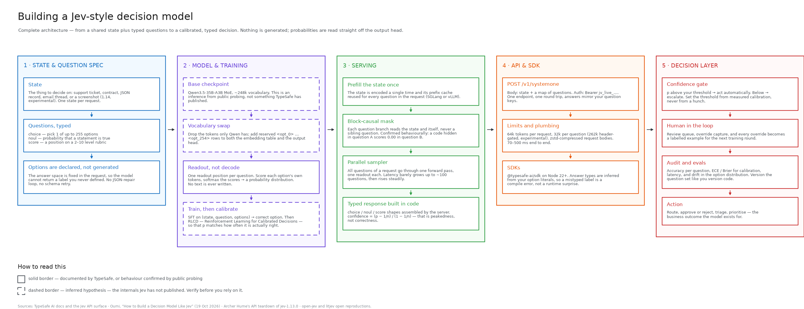

# Building a Jev-style decision model

Complete architecture of a Jev-style decision model (TypeSafe AI's "System One"), drawn as an editable Excalidraw scene.



## Open the drawing

**One-click (editable):** copy the link below into your browser. Excalidraw fetches the scene straight from this repo.

```
https://excalidraw.com/
```

**Drag and drop:** download `jev-decision-model-architecture.excalidraw` and drag it onto [excalidraw.com](https://excalidraw.com). It opens as a live, fully editable drawing.

**Preview:** `jev-decision-model-architecture-preview.png`

## What the diagram says

A decision model is an ordinary LLM with two changes. At **training** time it learns to answer by scoring a fixed set of option tokens at a single readout position, so probabilities are read straight off the output head instead of being parsed out of generated text. At **serving** time the state is prefilled once and every question in the request is answered in one forward pass, each question isolated from its siblings.

The scene runs left to right in five lanes:

| Lane | What it covers |
| --- | --- |
| 1 · State & question spec | The state being decided on, and the three typed question kinds — `choice` (1 of up to 255 options), `noul` (probability a statement is true), `score` (position on a 2–10 level rubric). |
| 2 · Model & training | Base checkpoint, vocabulary swap for reserved `<opt_n>` tokens, the readout mechanism, then SFT and RLCD calibration. |
| 3 · Serving | Single state prefill, block-causal mask that isolates questions, the parallel sampler, and the typed response builder. |
| 4 · API & SDK | `POST /v1/systemone`, request limits and compression, the typed SDKs. |
| 5 · Decision layer | Confidence gating, human-in-the-loop review, audit and evaluation, and the downstream action. |

## Published vs inferred

Solid borders are documented by TypeSafe or confirmed by public probing. **Dashed borders are inferred hypotheses** — the internals Jev has not published. Treat those as a starting point to verify, not as fact. In particular:

- The base checkpoint is *probably* Qwen3.5-35B-A3B with a swapped vocabulary.
- The training recipe is *probably* SFT followed by RLCD ("Reinforcement Learning for Calibrated Decisions"). TypeSafe has published the name, not the method.

## One thing to internalise before you build

`confidence` for a Choice answer is `(p - 1/n) / (1 - 1/n)` — a measure of how peaked the distribution is, not whether the answer is correct. A concentrated distribution can still be confidently wrong. Set the gate in lane 5 from measured calibration, never from the number itself.

## Sources

- TypeSafe AI documentation and the Jev API surface
- Oumi, *How to Build a Decision Model Like Jev* (19 October 2026)
- Archer Hume's API teardown of `jev-1.13.0`
- `open-jev` and `litjev` open reproductions
